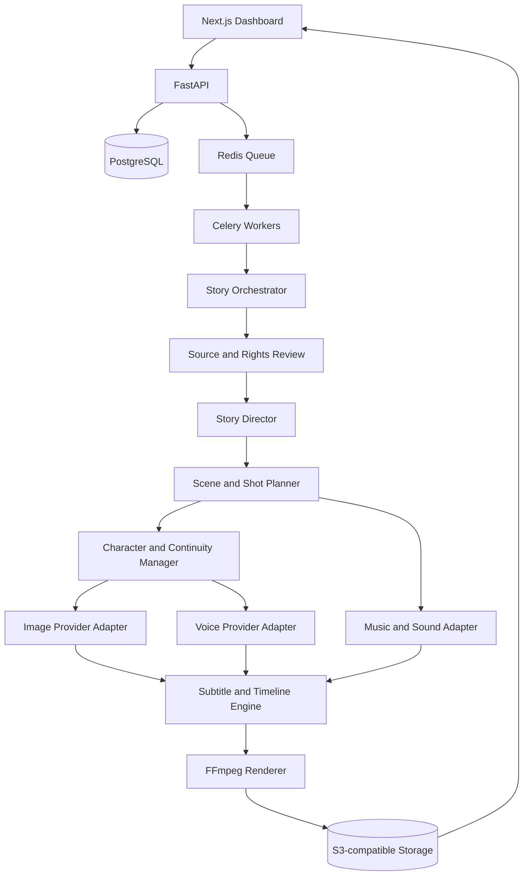

# CineKatha-AI Architecture

**Status:** Proposed architecture; implementation is pending.

## 1. Product goals

CineKatha-AI is a cloud-first, modular pipeline for transforming a story into a long-form cinematic video (initial target: 16:9, 1080p). It must support original stories and sources whose rights have been verified.

Core quality goals:
- Narrative fidelity: preserve plot, characters, chronology, and tone.
- Cinematic direction: scene objectives, shot sizes, camera movement, lighting, and transitions.
- Continuity: stable character identities, locations, props, and visual style.
- Performance: expressive voice direction, dialogue timing, ambience, and music.
- Reproducibility: save prompts, provider/model versions, assets, and job settings.
- Cost control: estimate and disclose provider costs before paid generation.

## 2. High-level components

## 3. Application layers

### Frontend
Next.js dashboard for projects, source input, script review, scene review, provider settings, job progress, cost estimates, and exports. The UI should expose human approval checkpoints before costly or irreversible steps.

### Backend API
FastAPI owns authentication, project CRUD, validation, job submission, provider configuration, signed asset access, and status reporting. Long-running generation must run in workers, not in request handlers.

### Persistence
PostgreSQL stores users, projects, source metadata, story versions, characters, scenes, shots, assets, provider runs, job state, costs, and audit events. Large media files live in object storage; the database stores metadata and object keys.

### Queue and workers
Redis + Celery initially handles asynchronous jobs. Jobs should be idempotent where possible, retry transient provider errors with bounded backoff, and expose progress and failure reasons.

### Story engine
1. Parse and normalize source material.
2. Record provenance and rights evidence.
3. Build a story bible (characters, setting, timeline, themes).
4. Produce an outline and screenplay draft.
5. Split into scenes and shots with estimated durations.
6. Run continuity and narrative validation.
7. Require review before generation when configured.

### Media engines
- Image engine: prompt construction, generation/source retrieval, asset validation, and character/style references.
- Voice engine: narration/dialogue, speaker mapping, pronunciation, emotion and delivery tags, timing metadata.
- Music engine: licensed tracks or generated audio with mood, cue, duration, and rights metadata.
- Subtitle engine: dialogue/narration alignment, SRT/VTT generation, and burn-in/sidecar options.
- Video renderer: timeline assembly, transitions, audio mixing, subtitles, scaling, encoding, and output validation using FFmpeg.

## 4. Provider adapter contract

Provider implementations must sit behind interfaces. The engine should not depend directly on a vendor SDK.

Each adapter should declare:
- Provider name and capability set.
- Configuration requirements and secret references.
- Supported input/output formats and limits.
- Estimated cost or an explicit "unknown" estimate.
- Timeout, retry, and rate-limit behavior.
- Data retention/training disclosures where available.
- Attribution and license metadata for returned assets.

Provider selection should support local/free, hosted-free, and paid tiers. Paid calls require an explicit project setting and a cost confirmation policy.

## 5. Suggested core data model

- User
- Project
- SourceDocument (origin, author, publication details, rights status, evidence)
- StoryVersion
- StoryBible
- Character (canonical description and reference assets)
- Scene (order, location, time, narrative purpose, duration)
- Shot (framing, camera, lighting, action, prompt, duration)
- DialogueLine (speaker, text, emotion, pronunciation)
- Asset (type, storage key, source/provider, license, checksum)
- GenerationRun (provider, model, parameters, status, cost)
- RenderJob (timeline version, output profile, status, output asset)
- AuditEvent

## 6. Job lifecycle

`draft -> validated -> queued -> processing -> review_required -> approved -> rendering -> completed`

Failure states should preserve logs and completed intermediate assets. Cancellation should stop future work and clean temporary resources without deleting user-approved assets.

## 7. Security and privacy

- Store secrets only in server-side secret management or environment variables.
- Never expose provider keys to the browser.
- Enforce per-user project authorization on every API and object-storage operation.
- Use signed, short-lived URLs for private media.
- Validate uploads, file sizes, MIME types, and archive contents.
- Apply quotas and rate limits to expensive operations.
- Keep an audit trail for source rights decisions and paid provider usage.
- Define retention and deletion behavior before production launch.

## 8. Deployment

Initial target: Dockerized services (web, API, worker, PostgreSQL, Redis) plus external or self-hosted S3-compatible object storage. Production deployment should add TLS, backups, monitoring, structured logs, health checks, migrations, and separate development/staging/production configuration.

## 9. Rendering profile

Initial output target: MP4, H.264 video, AAC audio, 1920x1080, 16:9. Frame rate, bitrate/quality, audio loudness, subtitle style, and fallback behavior should be configurable. Validate output duration, resolution, stream presence, and audio/video synchronization after render.

## 10. Open decisions

- Authentication provider and tenancy model.
- Exact provider adapters and their terms.
- GPU/image generation hosting strategy.
- Cost estimation model and spending limits.
- Character consistency strategy across image providers.
- Voice alignment and multilingual pronunciation approach.
- License selection for this repository.
